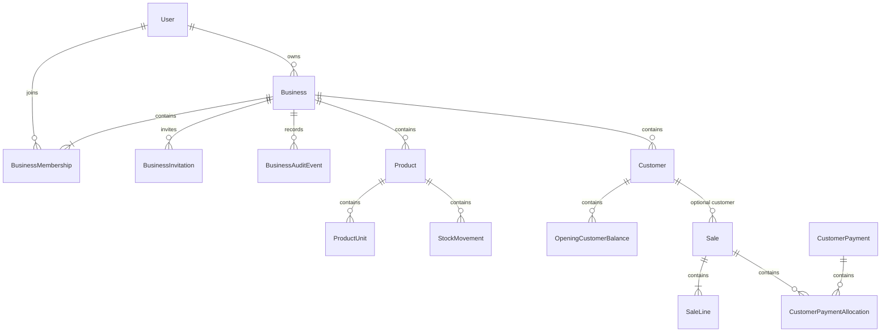

# Business inventory: specification and delivery plan

Each business is a separate tenant in one shared database. The agreed API scope is now implemented through the operations phase.
See [operations and rollout](inventory-operations.md) for the completed contracts.

## Agreed scope

- Record goods purchased and sales completed outside the application.
- One currency per business. Preserve actual sale prices on transaction lines.
- Opening stock, receipts, sales, returns, damage/loss, and stock counts create
  movements with actor/reason history. Avoid unexplained quantity overwrites.
- Product-specific units and conversions: store quantities in a base stock unit
  and preserve the unit, conversion factor, and price used on each transaction.
- Customers have opening debts, credit sales, payment history, and derived balances.
  Payments record money received elsewhere; this is not payment processing.
- Settings include notification email, timezone, daily local notification time,
  and low-stock email toggle. Reorder thresholds belong to products in base units.
- Daily email: one summary per business of products at or below their reorder
  threshold. Send nothing when no products qualify. Use the durable outbox.
- Basic reports and Excel exports; controlled corrections and audit history.
- Defer multi-location inventory, payroll, tax/accounting engines, and gateways.
  Profit reporting waits for an agreed costing method and monetary rounding policy.

## Roles and permissions

| Role | Authority |
| --- | --- |
| Owner | All business administration; appoint/manage admins; ownership authority |
| Admin | Settings, ordinary staff/viewer invitations and management, inventory/customer administration |
| Staff | Register purchases/sales and payments received at sale |
| Viewer | Read-only inventory/reports when those endpoints are built |

Only the owner appoints or changes admins. Member administration cannot demote or
deactivate the owner. Ownership transfer is a separate owner-only guarded operation.
Staff later-payment permission is disabled by default and can be granted/revoked
per membership. Owners/admins have effective permission; viewers never do. Future
payment endpoints must enforce the live permission, which grants no refund or
stock-adjustment authority.

Accounts have no global business role. All authority comes from live tenant
memberships. Catalog/global-administration routes are removed and old catalog data
is deleted, including temporary archives. See [retirement notes](legacy-retirement.md).

## Data model



Implemented entities:

- `Business`: GUID tenant ID, owner user ID, name, immutable currency, notification
  email, timezone, notification time (default 09:00), email toggle, creation UTC.
- `BusinessMembership`: composite BusinessId/UserId key, role, active flag, optional
  later-payment permission, join UTC. One account can join multiple businesses.
- `BusinessInvitation`: business, normalized email, random-token hash, assigned
  role/permission, inviter, seven-day expiry, accepted/revoked timestamps.
- `BusinessAuditEvent`: business, actor, optional target user, action, UTC timestamp.
  Authority changes are audited; admins can page through audit events.

Future tenant entities must include BusinessId, tenant-scoped unique indexes, and
composite foreign keys to prevent cross-tenant product/customer/transaction links.
Add default query filtering and write validation to future inventory repositories.
This delivery uses explicit tenant-qualified queries and live membership checks;
it does not claim the legacy catalog is isolated inventory.

## Initial API

All routes require bearer authentication. Business creation and settings/member/
invitation writes require recent authentication and the auth rate-limit baseline.
Private business responses, including early errors, use no-store.

| Route | Purpose |
| --- | --- |
| POST /businesses | Confirmed user creates business plus Owner membership atomically; 201 |
| GET /businesses | Paginated active memberships for the caller only |
| GET /businesses/{businessId}/settings | Owner/Admin settings projection |
| PUT /businesses/{businessId}/settings | Update name/email/timezone/local time/toggle; 204 |
| GET /businesses/{businessId}/members | Owner/Admin paginated member list, including inactive members |
| POST /businesses/{businessId}/invitations | Queue invitation; 202, never return the raw token |
| POST /business-invitations/accept | Submit token while authenticated with the invited confirmed email |
| PUT /businesses/{businessId}/members/{userId} | Change role, active flag, later-payment permission; 204 |

Example creation:

```json
{
  "name": "Afeez Supplies",
  "currency": "NGN",
  "notificationEmail": "inventory@example.com",
  "timeZoneId": "Africa/Lagos"
}
```

Currency validation checks three-uppercase-letter shape, not a full supported-code
registry. CurrencyDecimalPlaces is selected at onboarding (0-4, default 2), remains
immutable through settings, and defines the posting rules described in phase 3.
Use portable IANA timezones; the host's timezone database validates the supplied ID.
Currency cannot be changed through settings. Notifications are only configured now;
the phase-6 scheduler now enqueues daily low-stock summaries.

List defaults: page 1, size 20; caps: page 1000, size 100, offset 10000.
Assignable roles: Admin, Staff, Viewer; Owner is assigned only during creation.
Nonmembers get 404; insufficient business authority gets 403. Live membership
changes affect subsequent requests without logging users out of unrelated businesses.

Invites may target existing or new users. Recipients register/confirm their email,
sign in, and submit the emailed token. Acceptance validates address, expiry, unused
state, and the inviter's current authority inside one writer transaction. Reissuing
for the same tenant/email invalidates previous outstanding invitations. The encrypted
outbox has a shorter delivery lifetime than seven days; invite validity is not a
guarantee of seven days of SMTP attempts. Cancellation/listing and bounded expiry cleanup
are implemented in the operations phase. Authority audit events contain no tokens/email bodies.

Hard account deletion is blocked if business history exists. Deactivate memberships
to remove access; business closure retains history and blocks ordinary work. Account closure
is deactivation; it does not promise automatic erasure of financial references.

## Delivery phases

1. **Foundation (this delivery):** business creation/list/settings, membership and
   invitations, owner protection, stored payment permission, authority audit events.
   Test cross-tenant access, global-role bypass, live permission revocation, one-use
   email-bound invitations, and rollback when outbox persistence fails.
2. **Inventory (implemented):** products/categories, base units and conversions, opening stock,
   movement history, reorder levels. Prevent negative stock by default. Set decimal
   quantity/conversion rules and make an explicit legacy-catalog migration decision.
   See [the inventory API and quantity rules](inventory-foundation.md). Legacy
   catalog data remains separate; no automatic tenant assignment is made.
3. **Purchases/sales (implemented):** multi-line transactions, actual prices, suppliers, effective
   versus entry dates, atomic stock updates, idempotency and concurrent-sale safety.
   See [posting and money rules](purchases-and-sales.md). Business-declared currency
   precision defaults to 2; actual prices retain six decimals and line totals round
   midpoint-away-from-zero to the declared precision. No payments are assumed.
4. **Customers/debt (implemented):** profiles, opening debts, credit sales, payments/
   allocations, live later-payment permission, current/overdue balances, and admin
   payment reversals. Overpayments/unallocated credit are rejected. See the
   [customer and payment API](customers-and-payments.md) for contracts and legacy handling.
5. **Corrections (implemented):** returns, restockability, physical counts, controlled stock/sale/
   payment reversals and audit reasons. Preserve completed transaction history.
6. **Operations (implemented):** daily timezone-aware summaries with business/date deduplication,
   outbox retries, reports and tenant-scoped Excel exports with spreadsheet safety.

Implementation references: [ASP.NET Core resource-based authorization](https://learn.microsoft.com/aspnet/core/security/authorization/resourcebased)
and [EF Core multi-tenancy](https://learn.microsoft.com/ef/core/miscellaneous/multitenancy).

The implementation also completes invitation cancellation/listing, ownership
transfer, bounded invitation cleanup, business closure/reopening, account
closure, and removed legacy routes. Review the operational contract in
[inventory operations](inventory-operations.md). Deployment still needs real SMTP,
protected persistent keys, trusted proxy configuration, backup scheduling, and a
restore rehearsal. Multi-location stock, supplier debts, taxes, costing/profit,
and a frontend remain outside the agreed inventory-only scope.
